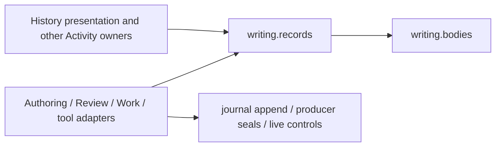

# The Writing Engine: from a selected passage to a recorded result

Laplace Writing connects a human's current project and reading position to a bounded agent session, canonical editing and research tools, and inspectable results. The same manuscript, claim and evidence identities connect the reader, conversation, logical structure, Research, figures and History. A conversation's confident answer is not the record of what changed: follow its application, run, source or proof receipt.

For a fresh installation, begin with [Agent startup](writing-agent-start.md). The [release implementation map](writing-evaluation-release.md) names the owners and release limits. This walkthrough is a maintained owner and navigation map. Developers changing the source start from the [source map](writing-source-map.md): entry points, routes, owners and their state files, the passive read seams, the frontend modules and their lifecycle, and how to change and test a feature. Observed live and release acceptance belongs to the named evidence records and the delivered package's `release/current-acceptance.json`, rather than a blanket audit date for this document.

**Historical architecture:** [The Atlas System walkthrough — 2026-08-16](../atlas_system_walkthrough.pdf) explains the deeper ingestion, graded-tree, geometry and reconstruction design. It is a historical document, not current Writing App acceptance. Its corpus counts, timings, CPU/GPU statements and proposed hardware migration describe that date. Do not apply them to a new machine or release. Its source begins at `walkthrough/main.tex` and `walkthrough/01-overview.tex` in the engine repository.

## Provenance and governance

Governance here is implemented through ownership, scope, guards and retained decisions. These are application mechanisms, not a claim of comprehensive operating-system isolation.

| Mechanism | What it governs | What remains a judgement |
|---|---|---|
| Selected project, manuscript edition and source addresses | Which current files and passages an operation may address | Whether the proposed scientific change is sound |
| Canonical mutation owners and revision guards | How a change is validated, applied and recorded; stale input is refused | Whether the author wants the change |
| Author and independent-review roles | Available operations: independent review can record findings/tasks while reviewed artifacts remain unchanged | Independence and quality of the review itself |
| Proposal decisions and application receipts | Pending, accepted, rejected and superseded versions; exact effects already applied cannot be offered as another application | Editorial acceptance and scientific qualification |
| Recorded actors, hashes and currentness | Who was recorded as acting; which bytes/revisions were read or produced; whether they still match | Understanding, entailment, physical validity and completeness |
| Retained history and explicit import events | What happened and what an export preserved or omitted | Whether a new evaluator has reproduced it |

The source guards are concrete. Manuscript writers compare the current addressed source with the exact `before` text and relevant source/plan revisions. Node-local concept edits use the focused node's mutation revision where the owner supports it; relations and structural changes retain their wider guards. A change receipt can advance a session's read baseline only when its exact owned file/object changes account for the mutation. An unrelated change requires a fresh scoped read; it is not permission to guess a new `before` string. These mechanisms live in [authoring_surface.py](../src/laplace/web/authoring.py), [pipeline/authoring.py](../src/laplace/pipeline/authoring.py), [core/receipts.py](../src/laplace/core/receipts.py) and the individual owners below.

Human editing and agent proposals remain distinguishable. Direct editor saves have source-addressed change records and Undo. A proposal is a versioned candidate, not a saved manuscript. Accept, reject, keep-current and explicit supersession operate on its guarded version. Terminal revisions remain inspectable as comparisons, with no second Accept action. Cross-turn fulfillment uses exact effects and occurrence identity, not text similarity. See [manuscript_proposals.py](../src/laplace/manuscript/manuscript_proposals.py) and [author_history.py](../src/laplace/work/history.py).

Provider credentials stay with the provider CLI. Role/tool restrictions and project-path checks do not sandbox every process, isolate OS accounts, or certify an external tool. Use the actual capability and error reports for the host being evaluated.

## 1. The human selects the work

The project library resolves a stable project ID to its manifest and chosen manuscript edition. The display title, scientific question and printed TeX title have different owners: changing the library name does not rename files or rewrite the book. Project home exposes purpose, current manuscript, active work, writing settings and callable stages.

In **Manuscript**, selecting a passage gives the conversation its actual source context. In **Logical structure**, attention names the selected canonical object or the exact member IDs of a displayed group. Reader chapter order, authored containment and typed logical dependencies are separate structures. In **Research**, a selected claim/result or an explicit literature target supplies the relevant scope. The app should not infer “this” from a stale selection in another view.

The main frontend owners are [workspace.mjs](../src/laplace/web/static_shared/workspace.mjs), [workspace-project.mjs](../src/laplace/web/static_shared/workspace-project.mjs), [walk.mjs](../src/laplace/web/static_shared/walk.mjs) and [concept-explorer.mjs](../src/laplace/web/static_shared/concept-explorer.mjs). Source selection is owned by [manuscript_source.py](../src/laplace/manuscript/manuscript_source.py); registry/display identity by [writing_projects.py](../src/laplace/projects/library.py) and [pipeline/registry.py](../src/laplace/pipeline/registry.py).

Before a manuscript request is sent, the editor attempts the appropriate scoped draft save and recaptures context. A draft that cannot be saved can be attached explicitly as unsaved text. That text is not a persisted source guard. Source conflicts remain visible, and unrelated work is not made dependent on an unsaved paragraph elsewhere.

## 2. A session receives bounded context and discovers tools

[workspace-session.mjs](../src/laplace/web/static_shared/workspace-session.mjs) manages conversation selection, drafts, model controls and event display. [authoring_surface.py](../src/laplace/web/authoring.py) owns the logical session/turn and current workspace context; [writing_provider.py](../src/laplace/writing/provider.py) adapts the provider process. Switching the displayed conversation detaches its listener, not its running work.

Context wording follows one presentation projection in `pipeline.authoring.prompt_framing`, derived from the source observation and declared project capability. A source-optional project with no manuscript receives project purpose/context and authorised project/artifact language. Its capability projection shows Research when the Research owner serves the project from inside the project's own home (`research_surface.owner_home`), so a campaign reaches its result catalogue before any manuscript exists; manuscript, review, presentation, reader-plan and concept capabilities keep their rules, and the Research view offers claim binding only where the project has concepts. The same project answers `logical_plan` (plan, catalog or one node) with a bounded `NOT_AVAILABLE` record instead of an unknown-project refusal: the source-optional layout has no logical-plan (concept graph) owner, which is reported separately from its selected manuscript status (`manuscript`), and the record names the supported reads (research, material references, artifacts, metadata) and promises no action that would create a plan; help for `logical_plan` and `logical_plan_change` carries that `project_availability` with permissions unchanged, a change is still refused (now saying why), and a genuinely unknown project is still refused as before.

**Project state stays put when a manuscript starts.** A registered source-optional project keeps its own engine state (research records and runs, research figures, reference associations) in its declared state home, `storage_dir`, which is the project's manuscript home. Starting or selecting a nested working draft (Home, Add manuscript, `start_manuscript`) moves only the selected source and compile root (`root`, `manuscript_dir`): chapter edits and builds follow the draft, while Research, references and run or figure links keep the same ids, revisions and pins. One rule, `manuscript_source.project_state_dir`, decides this for the Research and references owners; paper projects and every read-only or foreign source keep their existing coordinate, and nothing is copied or relocated. A receipt-backed writing-artifact link (`/research/artifact` with `owner=writing-artifact` and `artifact_id`) compares its path through the artifact owner, where a manuscript-scoped artifact lives beside the selected draft, so it reads the same bytes as the native `read_artifact`; plain Research run and figure links keep the state home.

**One JSON record from a large source.** The repository reader (`repository {action:"read"}`), the artifact reader (`read_artifact`) and the material source reader (`material_references` source, preview and workspace-source) accept `pointer`, an RFC 6901 JSON Pointer (`""` is the whole document). The reader reads at most the cap plus one byte even if the file grows after its size check (64 MiB for repository sources, 2 MB for artifacts), parses those bytes once (parse size and time reported), selects one value and pages that value's JSON serialization in Unicode characters (default 6,000, maximum 40,000), keeping source key order and original number spellings. `json_record` names the pointer, type, member count, `value_chars`, `value_sha256` and `source_sha256`; the continuation carries `expected_sha256`, so a changed source is a revision conflict rather than a mixed record. Missing, malformed or ambiguous (duplicate-key) pointers, invalid JSON, oversized or growing sources, selected values nested deeper than 256 levels and unpaired UTF-16 surrogate escapes are refused, and every refusal message is bounded at the transport boundary (at most 1,024 UTF-8 bytes as a serialized JSON string, escapes and quotes included, plus a declared 16-byte HTTP envelope; a source-controlled key or location is cut to a readable prefix that names its full length and a sha256 prefix); the source fence, perimeter and permissions are the reader's own. Every record result's `human_read` URL (from `record_read`) opens that same record page under the same pin, so a changed source is refused there too; an artifact record opens through the material reader's artifact preview, never as the whole file. `restart_read` is the separate, unpinned read of the current source from the first character. The reader shows which value it is and refuses to join a page of another record or revision (`laplace/core/json_record.py`, no storage or cache). A resolved manuscript keeps narrative framing. Missing or ambiguous expected source stays explicitly unresolved with its existing diagnostics. Both the context parts and turn suffix consume this projection; mode, permissions and source/evidence guards do not change. Source selection changes the existing part tokens, and framing reuses `details.document` rather than discovering source again.

A new turn starts fresh execution observations; the previous completion, dependency state and provider phase do not describe it. Only session-mailbox ordinals and proven same-admission launcher metadata carry forward. Exact-turn fences prevent late updates or finalization from replacing a newer execution. The conversation catalogue names the latest admitted turn within its ledger cut separately from the last saved reply; a completed older reply does not complete the current request.

The execution owner publishes changed capabilities on its existing sequenced stream, scoped to project, session and logical turn. The UI uses that observation or an explicit exact status refresh, never the provider name alone, to enable steering. Admission blocks switching while its request settles; rendered conversation buttons unlock in place afterward, without replacing focus or drafts. Selecting another conversation preserves the running turn and its original input target.

Live input modes follow the owner's capability and declared delivery route together. Native steering requires `can_steer` and `native_rpc`; queued input requires `can_offer_input` and `project_tool_boundary`. **Queue input for next tool result** saves the exact input under an ordered control ID. Known admission clears only the unchanged submitted draft; newer typing survives, and the saved text remains inspectable. One queued input can await publication while the author composes the next. The existing input owner prepares scope once, retains its verified message and fixed journal-row identities before advancing a baseline, then constructs the next project-tool result. **Sent with a project tool result** releases that slot; it does not prove model attention, understanding or action. A failed or unconfirmed publication remains visible, never automatically replayed.

The tool-result projection reuses the existing 2,000-character input-preview budget. A fitting prepared message is included once. Otherwise the original request and disjoint prepared-context preview carry separate completeness and an exact read handle. Unpublished context does not advance its baseline. An actual first complete read can record that retained delivery only while its original scope remains current; a later old read is historical inspection and cannot replace a newer baseline. Rereads never prepare again. Recovery in the same invocation checks the exact fixed journal identities and refuses substitutes. An unrecovered persistence failure is terminal for that input: its verified prior attention is restored once only while the failed input still owns the current basis. Damaged preparation, request or body cannot restore sidecar-claimed scope; that input's authority is conservatively invalidated and requires fresh inspection. Later boundaries and finalization never cycle or replay the failed input. A retry requires an explicit new control through the existing admission owner. Publication failure after a successful project operation preserves that operation's outcome, alongside the delivery warning.

Default execution summaries share one compact control receipt projection: identity/order, host/state/terminal disposition, publication completeness and exact read/delivery handles remain visible; recovery preparation, context snapshots, submitted payload and native result bodies do not repeat in controls, last_control or remote active.control. Exact controls/item_id inspection and internal recovery still read the original verified rows. This bounds transport bytes, not acknowledgement-file parsing or journal IO.

The pane observes only the exact unresolved control with its existing selected-session timer; switching, closing or settlement ends observation. Reload can recover the owner slot without guessing which local draft was submitted. Direct native acknowledgement has no control ID: its actual response remains associated with the original project, conversation and turn before view checks. Completing/detaching during the response does not lose that outcome; only matching submitted text is settled once, with no fabricated receipt or polling.

Claude invocations request `outputStyle: default` through the CLI's scoped `--settings` JSON, for initial and resumed launches. Global preferences, project/security settings and the project gateway remain unchanged. Provider init records what actually took effect. The current shared operating kernel includes both transport declarations: a Claude-only declaration change therefore also changes the emitted Codex kernel and requires the existing binding migration. Provider-specific kernel projection is a separate design question; this is not observed provider parity.

[writing_operating.py](../src/laplace/writing/operating.py) separates shared rules, project instructions and live selection. Current source, profile and tool identities travel with that operating context. Historical handoffs and full responses remain available through explicit reads; ordinary context does not need to repeat every prior turn.

The native dispatcher is `laplace_project`, already bound to the selected project and role. Its call shape is:

```json
{"operation":"help","payload":{"operation":"source"}}
```

`help {}` gives a compact catalogue. Per-operation help supplies the deployed payload, preconditions, effects, limits and recovery route. Do not probe an unknown operation with an empty payload: `task`, `note` and other names are writes. The contract is [writing_contracts.py](../src/laplace/native/contracts.py); dispatch and compact action receipts are [writing_tools.py](../src/laplace/native/tools.py). HTTP adapters and provider tools converge on the same owners.

## 3. Reads establish the basis for changes

`source` returns exact manuscript text and line addresses. `document` returns presentation state; it is not a replacement for reading the prose. `repository`, `reference_source` and `reference_text` expose configured scientific sources and bounded passages. Follow returned pagination when claiming complete coverage; a search result or a source hash is not evidence that the whole source was read.

Concepts, dependencies and reader placement are projected by [concepts_surface.py](../src/laplace/research/concepts.py), [corpus_ingest.py](../src/laplace/research/corpus_ingest.py), [project_structure.py](../src/laplace/manuscript/project_structure.py) and [storyboard.py](../src/laplace/manuscript/storyboard.py). Reading derived grade or containment must not itself author a new concept revision. An ancestor's membership/grade can be mechanically recomputed after a child changes; its authored scientific summary or proof does not thereby rewrite or re-prove itself.

Returned owner/shape/scope refusals at the semantic request boundary use the same `bank_failure` owner as thrown named-tool failures, once per validated bound invocation. The unchanged refusal carries the actual failure receipt and existing exact History read; a logging failure remains an explicit warning. This is separate from scientific `FAIL` results or arbitrary negative owner outputs. Failure recovery is a read-time observation over original same-project/turn journal events: a later successful read must match an exact retained recovery handle or one uniquely supported selector from the retained help contract. Read-baseline bookkeeping, other scopes, ambiguous selectors and missing digests cannot qualify. A recovery read after a failed write is inspection, not proof of a repeated write. The UI consumes this backend observation and retains the original failure plus matched READ identity; it does not infer task completion or retire technical reports. Failure-free selected pages do not inspect the original-read map. Failure-bearing pages share one request-local grouping from the captured original read receipts; the current rich fold has no immutable by-turn read index, so this costs one explicit metadata pass, not one per returned turn. Single-turn reads use the same mechanism, retaining original order, ambiguity and namespace without a persistent cache. Under the existing snapshot lock, the request detaches selected original-read metadata, candidate collections and their chronology; later duplicate reads or appended failures affect a fresh observation, not an already held cut. Proposal/context/result bodies are not cloned for this join. Matching HELP reads still pass the retained schema: Python equality alone treats `True` and `1` as equal and cannot establish integer field validity. Recovery action/failure chronology uses each original journal occurrence and refuses reused IDs, including cross-kind reuse; the general latest-ID order projection remains unchanged for Undo and other existing consumers. A later unrelated row cannot move an earlier matching action past a failure.

Response representation belongs to `writing_sources.content_items`: it emits one JSON text block plus separate typed images. MCP returns `content[]`; the Codex callback uses `success` plus `contentItems[]`, with unexpected exceptions represented as plain error text. No `structuredContent` duplicate is emitted. Compact shared capability guidance points to `help {operation:help}` for the executable `response_wire` recipe. It parses a serialized outer result once and, only for a known content wrapper, its single JSON metadata text block. Already-object results and semantic `owner_response` remain intact; transport flags do not mean owner/scientific success. The original stays local, diagnostics/emission stay bounded, media are not copied or dumped as JSON, and representation uncertainty never triggers effect replay. Repository image strings keep the existing specialized `code_mode_image_recipe`; ordinary source/prose strings are never recursively parsed. This documents the existing observed wire format and changes neither transport nor callback protocol version.

Shared payload admission lives in `writing_declarations`, beside the declarations and owner variant projections used by help, examples and contract digests. The semantic door first checks supplied values, selectors, nested versions and route token coverage without resolving source spans or counters. Only the exact guard fields that the selected route can materialize are deferred. Complete owner-call validation then runs before classification, baseline capture or owner effects. Direct proposal and technical-friction routes use the same admission owner. Shape failures provide static current-help recovery, without observing source through `account` or `classify`; existing bound failure banking and independent update publication remain separate. Owner permissions, leases, currentness and scientific `FAIL`/`UNPROVED` outcomes are unchanged.

Outer semantic `Request.by` is requested attribution, not an actor or permission. Existing READ/ACTION/FAIL rows retain its bounded text, byte count and SHA; they do not copy the request body. Literal declared owner `by` remains owner data and uses the existing codec's `owner_by` carrier inside a semantic payload, alongside `target`/`edge_target`. Conflicting outer and owner values refuse before reads; matching values still require selected owner admission. Forced `eigen:session`/`eigen:review` actors remain owner-bound. Task `by` is its existing typed origin label and review mode overrides it. `by_at` projects current declaration admission; its retained census is dated diagnostic evidence. Historical rows and kernels are not rewritten. This is a current tool-contract cutover, so existing strict binding compatibility rules apply.

Proposal source-anchor input comes from `proposal_preflight`: tagged `/1`, `/2` and supported tagless legacy forms remain accepted, and unknown versions refuse. Research record/producer input contracts live with their execution owner, including existing flat/wrapped alternatives and exact path scopes. Omitted producer dependencies declare no additional dependency coverage. A nonempty selected-result guard cannot validate creation when no prior selected record exists. Visual update shape and `upsert` share their exact protected-receipt/read-view fields; revision and protected-value equality are checked before those echoes are removed. Echoed views grant no render, source or evidence authority.

Current help inspection is separate from retained failure guidance and successful retry evidence. `GET /authoring/help` takes exact `project` plus either `turn_id` (the unique original admitted turn supplies its role) or an explicit `mode` for labelled unbound human inspection. It never borrows the active conversation or grants authority. Selector fields and typed JSON `context` come from `DECLARATIONS["help"]`; duplicate, unknown or conflicting fields refuse. Native help and HTTP share `writing_tools.help_response`, including live expected-token rendering. The HTTP envelope names `inspection.binding`, `turn_id`, `mode` and the native `help` response. Turn binding uses the existing addressed metadata index and verifies the selected original journal row SHA before taking its project/role; it opens no unrelated history/custody bodies. The help HTTP declaration opts into lossless query parsing at the shared writing intake, so blank unknown fields and blank/nonblank duplicates remain available for refusal; legacy routes retain their declared/default blank behaviour. This human read banks no provider READ, failure, context baseline or retry and does not change failure recovery standing. Inline conversation failures, saved-turn failures and Activity use one shared returned-guidance renderer and the existing exact inspector. The derived recovery projection emits its recorded READ through the canonical history handle owner, including the human GET coordinate; the frontend checks original project/turn, native/HTTP identity and requested READ ID before offering Open recorded recovery read. Inspect current tool help stays separately bound to the original turn and admitted role. Historical native-only recommendations remain saved data, and inspection never becomes a retry, task completion or failure resolution. Close returns to the known opener; stale view completion cannot restore old focus.

Activity History owns its consumed selector contract. Analytics fields do not become activity filters simply because both views share `author_history`. Activity reads reject `turn_id` or unknown fields before loading history. For a native turn audit use `author_history` with `view: telemetry`, `projection: trace`, `scope: turn`, the exact `turn_id` and optional outcome; HTTP also has the exact `/authoring/session-turn` failures view. Session filters, supported activity aliases and explicit exact IDs retain their meanings. HTTP forwards query keys to owner admission instead of dropping unknown selectors.

The efficient route is a small catalogue or scope, then exact object/source descent. Research has a summary index and a separate exact-result read. Conversations and History have small ordinary pages plus explicit full record/response reads. This bounds routine payload and DOM work without deleting the retained history.

Work evidence, the Work neighbourhood (one paged graph read drawn and listed by workspace-topology), exact saved records and selected material bindings use the existing evidence inspector. Each door passes an exact owner target; the inspector retains namespace and currentness qualifiers, reveals the result or error, and returns to the original reader. Global Activity/Settings visits retain the selected supported project view and Work or binding. A saved failure displays its original arguments and recovery; inspecting current help is a separate explicit read bound to its original admitted turn, never a retry or a resolved-failure claim.

Project **Review & notes** owns one proposal queue, cut and continuation through [workspace-review.mjs](../src/laplace/web/static_shared/workspace-review.mjs). Conversations show provenance and exact saved-version links; they do not maintain another project queue. A selected comparison opens in the manuscript and temporarily collapses the conversation dock without clearing its draft or stored preference. Legacy records lacking exact version/record pins require an explicit bounded history choice. Queue tabs count **inspected candidates**, not edits or a known total while continuation remains.

The [proposal navigation owner](../src/laplace/manuscript/proposal_navigation.py) projects the turn's stored workspace-context label for display, with an owner-type fallback when absent. The lightweight index caps oversized historical labels at 240 characters and marks truncation; new admitted labels already have that limit. This label is not canonical title identity, proof or application authority. Default cards show the label, affected files, recorded edit count and readable date; expandable provenance retains exact turn/version, label basis and conversation origin.

A candidate summary's `remaining` counts its owner-returned candidate rows; an exact child read's `remaining` counts only the selected returned edit. `read_scope` names that distinction. The frontend keeps parent `candidate_summary.remaining` separate while loading one child body and re-reads the exact parent and demanded child after a decision. A stale child's eligibility cannot establish whole-candidate readiness, and a failed maintenance read cannot revoke an already recorded effect acknowledgement.

Ordinary Work reads share one request-local source and artifact-path observation through the existing owners. The same Work task snapshot supplies the closed dispatch selection and prerequisite fold; [author_history_metrics.py](../src/laplace/work/author_history_metrics.py) detaches the required child, session, settings, binding, reply and immutable read-receipt metadata from one index cut. Original selected rows still receive exact hash checks, and later or out-of-scope records cannot enter that cut. The small framing projection in [pipeline/authoring.py](../src/laplace/pipeline/authoring.py) reuses only canonical raw fields while the state-file signature remains unchanged, separately from History's state-plus-feedback signature. Returned framing is detached, and the existing metadata cache is bounded to four roots and 64 paths per root; this adds no authority store or historical body copy. Cold or changed-state reads still parse the canonical JSON.

Work evidence routes are adapted by [project_work_views.py](../src/laplace/work/project_work_views.py), while [writing_sources.py](../src/laplace/projects/writing_sources.py) resolves recorded paths through configured repository fences. Ambiguous owners and escaping paths remain unavailable. Handle construction reads no source body. [writing_projects.py](../src/laplace/projects/library.py) builds material-source handles for project previews, stored references and workspace consumers, preserving native and HTTP coordinates, paging controls and the consumer project.

[workspace-material-observation.mjs](../src/laplace/web/static_shared/workspace-material-observation.mjs) is the shared read-only presenter for project Material, Workspace dependencies and Work. It shows observed and consumed identities separately, follows the owner's continuation and refuses a changed page basis with an explicit restart. Repository offsets count Unicode characters; native artifact offsets count UTF-8 bytes. Work's artifact links use the existing [writing-artifact.mjs](../src/laplace/web/static_shared/writing-artifact.mjs) opener with the original namespace, scope and expected hash. Each reusable Material or workspace reading slot owns an inspection epoch and presenter: reinspection destroys the prior observation before awaiting, so its late response or error cannot replace or disarm a newer basis. Independent Work panels remain separate and expire with the selected-work generation. Attach, adopt and remove stay in their controllers: inspecting source never records acceptance or renews completion. Bounded output does not imply bounded internal work; repository reads still hash the file and count its lines.

## 4. Owners apply changes and return evidence

For prose, the app uses [pipeline/authoring.py](../src/laplace/pipeline/authoring.py) and [manuscript_proposals.py](../src/laplace/manuscript/manuscript_proposals.py). Whole-object insertion/movement and heading operations use [manuscript_blocks.py](../src/laplace/manuscript/blocks.py) and [manuscript_structure.py](../src/laplace/manuscript/manuscript_structure.py). Their receipts distinguish a source change from a reader-plan change and support guarded Undo. Editing a generated JSON projection directly bypasses this contract.

Paragraph boundaries and planned units have different identities. Splitting a bound paragraph repeats its complete set of planned-unit IDs on the new source occurrences; joining adjacent paragraphs retains their union. A logical unit can therefore appear in several paragraphs, and a paragraph can serve several units. These presentation edits do not create, merge or accept logical claims. The physical occurrence, source bytes and reader-plan basis are checked together by [writing/reader_restructure.py](../src/laplace/manuscript/reader_restructure.py), reached through the existing `structure_change` / `paragraph_plan` operation. [reader-restructure.mjs](../src/laplace/web/static_shared/reader-restructure.mjs) validates and presents those same owner actions and receipts.

The owner records source commitment separately from history, author protection and provenance publication. If text is saved but recording stops, **Finish structural record** completes the missing steps from the retained intent and exact receipt; it never repeats the source write. Each operation retains a scoped provenance patch and its direction. Structural Undo and Redo reverse that recorded transition under current guards, preserving unrelated occurrences and restoring metadata absence where appropriate. Retained intents refer to predecessors rather than recursively embedding their histories. The editor's text, selection, caret and source-piece mapping share one DOM boundary interpretation in [walk.mjs](../src/laplace/web/static_shared/walk.mjs), so native multiline paste reaches the same guarded structural path as an authored paragraph break.

Bounded reads for guide authoring (2026-10-14). A model or browser editing one section's reader contract or paragraph plan reads `structure {view:detail, section_ids:[id], projection:guard}` (HTTP `/work/structure?...&projection=guard`): the same owner read projected to the exact `structure_change` calls with their guards (`expected_plan_revision`, `expected_contract_revision` or `expected_narrative_revision`, `expected_reader_basis`), the section's source binding, current authored values and input currentness, one copy of each reader basis, and the plain detail handle for members, support, evidence, relations and history; one subject per read (Sol N1): `subject:contract` (default) carries the section contract call plus a clipped identity row list of a four-row paragraph page (`paragraph_limit` names another page; `next_read` continues it under `paragraph_as_of`); `subject:paragraph` with `paragraph_id` carries that unit with its edit and remove calls; `subject:create` and `subject:reorder` carry those calls alone, each basis once, and hydrate no paragraph row at the owner. A guard read names exactly one canonical `section_ids` entry; `files`, `node_id` and `node_ids` are refused for it in the declared schema, the owner and the app's owner-read admission alike, with the plain detail read as the route that resolves them to a canonical id. Measured on the live guide in fresh processes: contract 8.9-11.0 KB, create 3.9-5.6 KB, reorder 3.7-5.4 KB where the plain detail was 69-180 KB; on a 17-member synthetic chapter the default contract read stays at 11.0 KB from four to twenty ordinary paragraphs. Receipts retain a `basis_index` of exact selectors under a declared budget of 6,144 retained bytes (UTF-8 of the serialization the journal writes, coverage marker included) and 160 entries with a coverage marker (Sol N2): a stale refusal names only selectors it indexed, says when a change lies outside its coverage, and never truncates a path or id; legal non-ASCII paths cost their encoded bytes. The browser consumes the same contracts: the Work view's Neighbourhood map and the Reader plan's relation map are drawn and listed by `workspace-topology.mjs` from one owner page, paragraph dialogs open on a bounded subject read, Activity opens on Changes with the owner's manuscript category and six-hunk record pages, and the argument record uses the object-header pattern (M5 C4-C6). Figures read `visuals {view:index}` (identity rows with `spec_revision`, drawing/evidence/presentation marks, placement comparison status and render identity, paged with a `cut`) and `visuals {id}` or `{ids:[..8]}` for the exact figure with its drawing source, render outputs and `placement_caption` comparison; `visuals {}` remains the whole catalogue (210 KB for 33 live figures; index 11 KB, one figure 6-9 KB). A stale-evidence refusal (`Consulted project evidence changed (...)`) now names every stale consulted family at once; each read receipt retains a bounded `basis_index` of the selectors it published, so `consumed_read_recovery.changed_reads[].changed_selectors` says which figure, section, file or citation use moved and `inspect_reads` offers the bounded current read for it; only the exact consulted read in `next_reads` renews a witness, and no read adopts changed evidence. A node placed in several plan sections mirrors the anchor beat of its FIRST placement in document order (outline order, parents before children, then appendices); `storyboard.reconcile_section_refs` and the full structure read judge that order identically, and a scoped detail read reports the whole plan's mirror eligibility, while `view:summary` states `eligibility_scope: NOT_ASSESSED` because it lists source correspondence only.

Bounded human display, the plan guard and the help owner (2026-10-14, M5 C10-C11). The Reader plan reads a selected section as its display, `structure {view:detail, section_ids:[id], projection:display}` (HTTP `projection=display`): one page of the same detail owner bounded to at most 12,000 B on a 20-paragraph, 17-member section (measured 11,864 B on the synthetic reproducer; the plain detail measured 728 KB there and 800,724 B on the live project): the section identity and source binding, the reader transition's authored fields and currentness, six paragraph list rows (proposition clipped at 160 characters, the authored fields the row did not carry named under `authored`, standing, and `doors` naming the calls the row offers), a six-row member page under the owner's membership cut, the placed narrative beats and the first evidence rows with totals, and the displayed scope's observation with its reader subjects as one compact ref (`laplace.reader-subjects-ref/1`: the subject ids and one digest over every subject's revision and effective inputs; a send guarded by it refuses exactly when whole bases would). A row opens to its whole text through the display read with its `paragraph_id` (stated once as `row_read`); the display and every default subject read clip authored text by serialized bytes and list the clipped fields, while the editor read (`edit_choices:true`) carries the call's exact complete `values`, so an editor opens on the authored text and a clear is a change (repair2). Reading is not editing: any row whose shown text is shortened (even with nothing else authored) offers Read whole paragraph plan through `row_read`, and a shortened reader transition offers Read full reader transition through its `values_read`; both are read only, admitted only for the same project, section and revision as the page, and leave any editor draft untouched (repair3). The section's narrative beats are read lazily: the page states their exact count in `spine_page` with one read (the display with `spine_offset`), which returns only a compact page of beats and its continuation, admitted for the same section and spine revision; each beat opens on `spine_page.row_read`, and a member row that is already a beat carries `beat: true` (release repair: a populated section with 13 beats measured 17.4 KB before, 11.8 KB after). Every call opens on a subject read when the door opens: `subject:contract|paragraph|create` with `edit_choices:true` carries the typed descriptors and choice lists on the one call, `subject:section` carries the section-level calls (link a source heading, prepare work, review), `subject:structure` with `paragraph_id` one row's split/merge previews and review call; the accepted four subjects are unchanged by default. The plan-level editors (plan item, narrative beat, add beat, move item) read `structure {view:plan}` (HTTP `view=plan`): the complete plan order, collections and spine identities with the same `revision` the full read publishes (3,993 B on the reproducer against 37,938 B full; 302,953-316,437 B full on the live project). The help owner serves two further concepts beside areas, journeys and controls: `diagrams` (one declared diagram per area with rank and group hints, drawn and listed by the typed topology view) and `checklist` (the acceptance rows generated from the declarations); the areas payload stays under 20 KB and names both reads. The Work neighbourhood folds a level wider than eight nodes to the nodes in focus plus one exact-count fold card that opens to a grid; every edge stays in the relation list. Colour literals live in `tokens.css` only (the semantic set plus a derived extended palette), enforced by `tests/test_design_tokens.py`; the person's tutorial progress lives in `laplace:learning:<project>` and the retired `laplace:guide:<project>` is migrated once and removed.

Manuscript, conversation and material surfaces (2026-10-14, M5 C7-C9). The Manuscript view is two bands over the text: the editor band (Write | TeX | PDF, document chips, Save changes, Build, Build details, Undo/Redo in Write mode, Drafts, Document setup) and the walk's reader row. Document setup is an object-header panel: the selected root with editable/read-only, class and PDF chips, the document files as relation rows, Template & layout as the primary action when the owner offers a template, and one Exact build basis disclosure; the template inspector's reviewed-proof row names the build receipt and PDF that Apply binds. The passage menu groups Edit, Insert, Structure and Ask with keyboard focus on the first enabled item; Undo/Redo stay on the keys. A proposal overlay opens with a step header whose ordinal and total come from the owner's candidate navigation ("Review change n of N · file", mode chip; a loaded-only scope says so). While the view is visible the shell sends one conditional build-summary read every 5 s with `known_revision`; an unchanged answer is the condition token only (`{project, unchanged:true, summary_revision, document_status, as_of}`, 229 B), and a block reload reads one section (`/walk/doc?sections=`) rather than the whole document. The Document outline reads 25 trimmed headings per page with an owner continuation. The conversation pane renders each turn from the owner's compact thread row (`/authoring/session view=summary`, 20 rows per page with `older_cursor`): identities, counts, short request and reply excerpts with complete-length markers and "Read the complete …" doors, facet chips (saved changes, failed attempts, reply standing), the artifact count whose relation rows load on request from the single-turn summary, and one Complete saved turn disclosure; a 20-row page is at most 20,000 bytes for ASCII, CJK and quoted-JSON carriers (excerpts are capped in serialized bytes, escaping included; the live entry measured 18,246 B for 11 turns), the usage meter travels once per page with its own provider and model, a capped artifact count says "at least" and the disclosure's header follows the current exact response (the entry count is shown as such when it differs), and the complete request, reply, selection quote, draft, steering, links, usage facts and delivery receipt are on `session-turn view=summary` / `view=turn`. The idle Manuscript poll's unchanged answer is the condition token and status word only (229 B); it settles nothing the reading view has not applied, so a source change deferred under a draft or a failed body read is still read and reconciled afterwards, and every body read, ordinary or recovering, passes the same owner admission guard (project, revision, observation schema) before it is applied. The message target, attached reading and intent are chips. App settings show the intelligence ladder only under Models & providers and open every family with a scope chip; project Settings list writing stages as an ordered plan and measure storage only on request; saved profile suggestions are relation rows with Compare as the only door. Material is the one shared-material mount (view=dependencies opens it): readers as relation rows, recorded files with an availability chip and Read as the primary action, bindings with a currentness chip. Research rows and cards carry the currentness word as a state chip, served from the owner's witness-stamp cache. Review carries Proposed, Versions, Comments, Notes and Closed; saved manuscript edits are Activity records. The typed topology module is registered in the served asset allowlist (`shared_ui._ASSETS`), which the startup snapshot requires for every imported module.

Changing the logical units is a separate explicit operation. [writing/reader_logical_restructure.py](../src/laplace/manuscript/reader_logical_restructure.py) validates authored successors and the disposition of each source occurrence and scoped attachment; [writing/reader_logical_publication.py](../src/laplace/manuscript/reader_logical_publication.py) joins that decision to the existing source, plan, provenance and publication owners. Splitting one unit or combining several retires their old identities while preserving addressed lineage. Qualifications, evidence, connective text and review obligations are accounted for explicitly; moving them does not renew scientific acceptance. The section exposes its latest structural operation after the editing dialog has closed, with the exact recorded outcome and an inverse only when its current guards permit one.

[writing/reader_restructure_reconciliation.py](../src/laplace/manuscript/reader_restructure_reconciliation.py) handles the narrower case where source was saved but recording must resume after another source edit. It requires current occurrence evidence and leaves later text untouched. The shared receipt offers compact disposition counts and bounded qualification facts before its full retained detail. Historical detail chunks are immutable; live inverse currentness is read separately. For native multipart reads, `coverage.complete` means the entire body is present in that response, while `at_end` and `has_more` describe continuation. A final chunk therefore need not be a complete body.

Selecting all text in an editable paragraph and pressing Backspace is a text edit. The walk snapshots it before native deletion, retains the empty face in the existing active/parked draft state, and persists it only through Save or enabled Autosave. Saving uses the existing `\par` empty-paragraph representation, so the paragraph remains editable and its before/after bytes are undoable. The explicit **Delete paragraph now** menu action is a deliberate immediate structural rewrite. It first projects the intended postimage and reuses the same capture/Undo locator to require a recoverable nonempty hunk before any effect. Its actual byte guard includes that current pass-through context. A sole paragraph with no recoverable context is refused; ordinary clear-and-Save remains available. The projected full source is request-local and never stored as another history snapshot.

Plain-text Undo and Redo share `historySpan` in [manuscript-editing.mjs](../src/laplace/web/static_shared/manuscript-editing.mjs). For a recorded deletion whose postimage is blank, the locator first requires a unique retained prefix/suffix match, then widens the inverse hunk into the nearest current complete nonempty neighbouring line. That neighbour is identical pass-through in before/after, protected by the fresh rewrite byte guard; bytes outside the retained fragment are current observations, not historical proof. It preserves untouched bytes and the rewrite owner's nonempty byte guard. Missing, ambiguous or changed context refuses; it never relocates an empty needle or substitutes a whole chapter as authority.


A single owner-served rewrite retry may carry the exact first pending receipt's `rewrite_retry` witness in either the flat HTTP body or native grammar payload. [review_surface.py](../src/laplace/manuscript/review_surface.py) defines that schema and hashes a closed, versioned original effect/attribution intent: resolved project/manuscript, file/span, actor, exact source before/after, passage, note/reason, scope and source attribution. Refreshed `expected` guards and delivery data are excluded; source whitespace and Unicode are preserved. The owner requires the exact new pending ID, stored digest, open status and matching original intent; old rows without that witness are never migrated by text/time matching.

Only after the source swap succeeds does the same rewrite owner resolve that pending row through the existing guarded feedback status writer, retaining the applied feedback ID in status history. A failed retry or swap leaves the pending instruction unretired. If status settlement fails after application, the effect acknowledgement survives with the unresolved pending ID and warning; the source effect must not be repeated. A previously attempted or closed lineage is refused, including an attempt banked before a failed swap whose outcome must be inspected. There is no new tool, store or automatic historical retirement.

Physical source mutations share [manuscript_source.py](../src/laplace/manuscript/manuscript_source.py)'s `source_mutation(paths, timeout=15)` lease. The caller declares its complete effect and rollback file set before fresh reads; resolved platform-normalized paths acquire cross-process locks in sorted order under one bounded deadline. Same-thread nested calls may use a subset, never grow that set. Live weak lock instances support reentrancy without retaining a request registry. Sidecars are transient `*.lock` files excluded by the existing source exporter. Source fences, optimistic guards and attribution remain with their original owners; this does not serialize uncooperative external editors or distinct hardlinks.

The ordinary rewrite/edit-in-place owner acquires the lease before rereading feedback and source and holds it through bank, swap and exact retry settlement. Its optional heading projection runs after source release, reacquiring the selected source namespace to check the saved postimage and update plan metadata without a check-to-projection gap. Batch owners collect transient source changes and explicitly invoke this follow-through after their outer effect/rollback and feature locks have released. No model, build or render work belongs in the source lease. The common primitive and ordinary review integration alone do not establish migration of every other source writer.

Proposal application and positive per-edit decisions declare the full selected TeX namespace as well as addressed files, because duplicate-label preflight observes more than the edited span. They recheck namespace membership before fresh validation, retain the lease through compensation, application attribution and sibling-anchor/decision banking, then run optional projection. The existing proposal publication FileLock remains outer; its wait and the source loop no longer retain the global authoring cache mutex. Block transactions likewise acquire their feature lock before fresh origin/destination guards and retain the complete source set through compensation. Structure transactions keep required source-and-plan compensation inside the physical lease, with plan metadata transactions as leaves. Chapter creation declares its absent target before effects. Physical lock keys are platform normalized; returned source paths preserve their resolved spelling for provenance and token homes.

`stage_source` is a shared exact-byte sibling staging helper, not another admission or history owner. Existing writers retain their bank-before-swap ordering and atomic replacement; staging fsyncs the intended bytes and preserves an existing file's mode. Neither physical leases nor staging establish consistency of unrelated registry, evidence or scientific state.

A raised required source-step failure joins the same compensation path as a returned refusal, while the complete physical set remains held. Failed compensation stays visible in the partial application's receipts. After all source effects succeed, failure to publish the parent application does not undo those effects: only an exact indexed match to the attempted application and its owner facts recovers the normal acknowledgement. Otherwise `source_effect_retained`/`source_applied` describe the lower source effects, `application_tracking` is `UNPROVED`, and no normal application ID or complete acknowledgement is returned. Review and native outcomes retain exact source receipt handles and a no-repeat warning; selected decisions do not bank acceptance, advance sibling anchors or rebase from that unrecorded object. The reader preserves the proposed draft and its guard, disables automatic replay and directs reinspection. A recorded application survives later context-maintenance failure with a warning. Its stored context-rebase state is a request, not proof of completed advancement.

The native feedback cure uses the existing `author_history` record view and `activity:feedback:<FB-id>` identity. If a post-effect comparison read or decision/sibling maintenance fails, the selected owner returns the known exact application/source outcome with a warning. An unavailable comparison carries no guessed rows, counts or fresh guards. The UI removes the unavailable comparison, keeps local draft state and requires explicit reinspection; it does not repeat the effect.

The raw TeX editor reads the existing `/projection/tex?view=source` owner observation: canonical file, displayed content and `expected_source_digest` come from one physical byte read, before CodeMirror newline normalization. Save carries that unchanged guard and compares it inside the source lease before replacement or version banking. An exact acknowledgement supplies the consumed guard and committed digest; it can advance only that editor file's basis, without replacing newer typing. A 409 retains the draft and names a fresh inspection route, and refused saves do not compile. Restore separately binds the selected saved file/version/body and the independently inspected live target; its first explicit gesture inspects and its confirmation never refreshes that guard automatically. Ordinary plain-text GET reads remain compatible. Once source bytes commit, snapshot/exemplar banking or later history refresh failure cannot turn that exact effect acknowledgement into a failed save. The response retains its consumed and committed file pins with a separate maintenance warning; an unconfirmed snapshot has no invented version ID.

Ordinary raw **Save** with identical guarded before/after bytes returns `changed=false` and creates no source rewrite, version, exemplar or ledger event. This holds on a first save, with changing actors and across more files than the archive retention limit. `bank=editor` is an automatic follow-through, not explicit archival intent. Actual A→B→A edits, explicit restores and deliberate archive calls remain separate occurrences; experiment, completion and scientific support events are not deduplicated by byte equality. A changed raw save's exemplar records its captured guarded preimage delta and recorded saver, not inferred authorship of a whole preexisting file. Feedback IDs mint under the canonical append lock, preserving old records.

`ProjectContext.feedback_ledger` names current selected-source intake in its editable or validated engine storage home. `Project.feedback_ledger` and `ProjectContext.pipeline_feedback_ledger` retain the separately declared generated-pipeline destination. Current artifact/read/request/exemplar callers use current context; pipeline findings, friction, desk and explicit ledger folds retain their declared pipeline scope. This classification changes no old ledger bytes and performs no ledger copy or union. Saved-version rail, history detail and restore share the exact VERSION/source-file/body resolver; metadata-only rail reads state `NOT_OBSERVED`, and basename-only legacy records stay unproved. A hand baseline needs exact source binding and a recorded machine label, which is not actor authentication; missing binding does not paint the whole file as authored hand. Its occurrence order comes from the existing editor-save index, not clock or directory spelling. New indexed occurrences also pin the exact source target and byte count; a damaged VERSION cannot change their applicability. Older index rows are not backfilled, and missing target pins do not prove newest-target attribution. Invalid, ambiguous or omitted newest applicable history leaves attribution unproved; an older valid snapshot cannot replace it. Target metadata is filtered before saved bodies are read.

Raw-reader follow freshness comes from the existing verified build input/output receipt, including the actual SyncTeX map. Matching PDF bytes or convenient modification times alone cannot certify a map. Byte-identical source touching does not invalidate an otherwise verified mapping; changed inputs/map or legacy missing receipts remain degraded. Follow replies are scoped to the selected file and editor generation, so late results cannot clear another note. Conflict wording uses the structured source owner refusal and preserves the draft's original guard.

An included source keeps its own file and line while its PDF, map, status and compile belong to the declared selected root. The projection owner validates that membership through the existing include traversal; it never searches neighbouring roots or PDFs. Project-qualified requests retain their expected `compile_root` and refuse changed selection, even when an old root is itself a document. An unqualified standalone documentclass remains its own root; an unqualified fragment requires an explicit root. Addressed selection reads skip candidate discovery and unrelated plans when the root is explicit or saved. A formerly discovered-only root needs an explicit existing source selection before these reads; the selection UI keeps full discovery. Async Follow/build observations preserve project, root, fragment and editor generation.

Visual placement leases the full root/fragment set, and explicit literature materialization leases the root/bibliography set before their fresh guards and source effects. They carry heading changes only in a transient collector and run optional projection after outer feature/source release. If visual spec or manifest publication cannot be confirmed after source placement, the existing HTTP, named and typed routes retain the exact source receipts and report metadata tracking as unproved. That partial result directs inspection before further action; it neither claims complete placement nor invites repeating the retained source effect. Cheap storyboard input reordering and bibliography wiring use the same physical owner; their compile probes occur afterward. Cheap reorder acquires source before the existing plan lock, reloads the consumed plan and refuses if its path or content changed while waiting. Compilation follows the exact consumed target after both locks release. Source acquisition and plan-lock waits each have their own finite bound; this is not a 15-second whole-operation guarantee. New manuscript scaffolding leases its declared new source set and refuses preexisting authored targets. Style preview and node-map instrumentation still alter isolated copies, and source-capable external library emitters without an active app applying caller remain outside this observed app closure.

For literature, [literature.py](../src/laplace/research/literature.py) owns acquisition, source reading and bindings; [literature_support.py](../src/laplace/research/literature_support.py) joins claim support to manuscript use. A bibliography entry identifies a source. A bounded reading receipt identifies a passage actually returned. A claim–source relationship records the authored use. Those are different facts; none alone proves that the source supports the claim.

For numerics, [research_surface.py](../src/laplace/web/research_surface.py) supervises declared producers and projects result records, inputs, outputs and currentness. Read `run_status` for the terminal outcome before recording or describing a run as complete. Result-to-claim and figure bindings retain explicit identities. Changing a pinned producer or input can make the old result stale while leaving its original output inspectable.

Research execution requires Linux subreaper, process-identity and pidfd capabilities. A detached guardian and supervisor establish ownership before starting the producer; either surviving owner cleans escaped sessions and adopted descendants if the other dies. Caller exit does not cancel the job. The declared execution timeout is followed by one shared cleanup attempt of at most six seconds; a zero exit or a result file does not establish cleanup. `run_status` keeps execution and `VERIFIED`, `INCOMPLETE` or `UNKNOWN` cleanup separate. Unresolved cleanup remains visible to the existing health/update gate. The acknowledged launch job stays immutable; monotonic progress and terminal proof use its existing receipt. The declared project run index retains exact job locators across manuscript selection changes, while compact pending handles drive health inspection. A retained handle with verified terminal cleanup is inactive and is pruned on the next explicit launch; background cleanup never changes launch's exact index proof. Historical receipts without this proof remain historical and unproved; the contract does not claim security isolation, unsupported platform parity or recovery after simultaneous loss of both cleanup owners.

For recognized supervision receipts, the top-level `pid` and `supervisor_start_token` are compatibility fields for the launch wrapper/guardian. Use `supervision.roles` for canonical role identities and `publisher` for the recorded terminal publisher. The shared run-status explanation distinguishes supervisor cleanup followed by guardian verification, guardian takeover, and supervisor survivor cleanup only from supported validated proof shapes. Missing, malformed or unverified evidence leaves the path unestablished; legacy runs are not retrospectively assigned new roles. Current help for run status, cancellation and producer execution shares the same owner contract. The annotation and run card explain evidence without changing its state or cleanup proof.

Python producer entries inherit the selected runtime, including safe-path mode. A script's directory or cwd is not an implicit import root. Use one explicitly authored in-scope entry bootstrap (for example `sys.path.insert(0, str(Path(__file__).resolve().parent))`) and qualified imports such as `study.core`; register the entry and all transitive project modules as dependencies. The owner adds no dependency directories or import loader. `PRESENT` proves a file is available and pinned, not that Python can import it. `--mode`, `--args-json` and the exact `--result` path remain the execution contract. Run-index mutation attribution captures the declared run home's exact `research_runs/index.json`, including absence; a missing pre-capture is unproved, while a captured preimage mismatch is a real refusal to advance read baselines.

Project text artifacts live in [writing/artifacts.py](../src/laplace/projects/artifacts.py), with an inert [writing package](../src/laplace/writing/__init__.py). [writing_tools.py](../src/laplace/native/tools.py) admits the role, delegates and records tool reads/actions; compatibility helper names only alias this owner. Work, History, material references and the human artifact route consume that same scoped path/read/store contract. Its only custody banking dependency is the deferred existing `authoring_surface._bank`; it has no transport backedge. Reading an ART ID reads the current physical path with a separate historical `recorded_revision`; `human_read` pins actual bytes, and `author_history` exact record reads recover old retained bodies. These are distinct promises. The metadata-only catalogue shares one request-local source basis, keeps latest-per-scoped-path ordering, gaps and paging, and never hydrates artifact bodies or grants currentness. Runtime help and route generation resolve both the actual adapter and concrete implementation through the artifact declaration. Review role admission and the exact dispatch-judge return-path exception are unchanged; executable independent review remains a separate permission obligation.

Writing journal reads live in [writing/records](../src/laplace/writing/records/__init__.py): one offset/hash metadata index, strict selected-row reads, the existing session/turn fold, and project talk scan helpers. History keeps its multi-owner Activity rendering and source stamps; Review, Work, artifacts, provider updates and tool adapters consume this same read owner. Compatibility names refer to the same implementation and lock/cache objects. `journal.bank_row` still appends; `authoring_surface._bank` still chooses proposal sealing, carrier rules and guarded baseline transitions. Provider jobs, live controls and source effects remain upstream.



An exact `activity:journal:` record or detail read verifies its selected row and the original supporting turn/session hashes under one captured cut. It resolves only the chosen public body and keeps actor, admitted settings, operation, arguments, recovery, measurements and original chronology. ART metadata verifies its exact row before granting a path or receipt identity. Unknown, ambiguous, wrong-project, stale or corrupt selections refuse; they do not silently adopt a newer cut or discover unrelated Activity families. The human HTTP and native `author_history` routes remain the same. Rendering the resolved selected payload/text also restores real navigation targets and readable summaries where the old broad projection displayed a custody reference or omitted its targets.

A selected proposal version changes only the derived proposal view; it does not manufacture a final reply or alter the original terminal carrier. Failed replies remain recoverable. An empty terminal answer does not retire a separately banked candidate: an exact versioned rejection or supersession is still required. Launched dispatch relationships follow the verified owning turn for replies, actions, reads and failures under the same captured cut. A stale ART row hash keeps its original refusal and reread instruction; it is not relabelled as an ambiguous ID with a path-based cure.

Metadata retains its existing four-root bound and Activity its three project/root views. The rich session fold deliberately keeps its existing mutable alias lifetime: it has no new eviction limit, and selected inspection never populates that rich cache. Cold index work remains proportional to the journal and suffix; exact warm reads open only selected original rows and bodies. A cache-lifetime redesign requires separate eviction/refold evidence, rather than borrowing the metadata limit or claiming these historical views establish current scientific acceptance. These read/cache bounds do not shrink retained journals or Git snapshots; storage and publication costs remain separate measured obligations.


For formal work, [formal_surface.py](../src/laplace/research/formal_surface.py) and [pipeline/formal_verification.py](../src/laplace/pipeline/formal_verification.py) bind checks to the chosen mathematical statement and actual toolchain/declaration. A theorem label, an authored proof or a successful program run is not a formal verification result. Formal execution also does not establish that the checked statement faithfully captures the informal scientific claim.

For presentation, [visuals_surface.py](../src/laplace/research/visuals_surface.py), [pipeline/visual_production.py](../src/laplace/pipeline/visual_production.py) and [document_style.py](../src/laplace/manuscript/document_style.py) distinguish a figure brief, rendered bytes, evidence bindings, manuscript placement and caption. An incomplete brief is not render-ready. Building and exporting the selected source differs from generating a style preview. Inspect the actual PDF and its links; a successful compile is not page-layout or scientific acceptance. A relative companion file can be current and mutable even when the exported PDF's identity is verified.

## 5. History makes the work inspectable

[author_history.py](../src/laplace/work/history.py) joins existing owner records into a paged timeline and telemetry; it is not a second mutation journal. Exact records/comparisons are loaded on demand. Actor/time fields come from recorded events, not a guess about who probably acted. Concept history distinguishes exact authored events from comparisons reprojected on current source.

[core/records/journal.py](../src/laplace/core/records/journal.py) records intent, step outcomes and durable appends. [core/bodies.py](../src/laplace/core/bodies.py) owns the public body-reference contract, canonical body encoding, retention, bounded reads, recursive resolution, the invocation-local budget and degradation diagnostics; [writing/bodies.py](../src/laplace/representation/writing_bodies.py) is Writing's policy over it (which row fields are bodies, the `contract/writing_bodies` store over [Atlas storage](../src/atlas/store.py), the legacy fallback, reply-metadata resolution). [core/records/capture.py](../src/laplace/core/records/capture.py) is the captured-log reader the talk index (`writing/records/_index.py`) builds on. Importing the leaf loads no controller or selected state. `authoring_surface` retains proposal/edit/provider metadata decoration before its private validated encoding seam, proposal seals, journal publication, folding, jobs and locks; compatibility names alias the same body owner. Direct History, proposal-navigation, update-resolution, tool-diagnostic and provider-usage consumers use this leaf. Strict reads still refuse corrupt/missing/unsupported bodies; tolerant reads retain the original evidence and errors. Provider metadata resolves only its outer retained body and keeps nested observation handles lazy. Current source files, owner ledgers and immutable historical bodies have distinct roles; no history migration or new store is introduced. Full O(diff) storage is not claimed merely because a summary response is small.

Engineering support for a named claim clause uses the existing concept and work owners. The canonical concept projection retains `engineering_support` entries with the exact work completion identity, proposition `meaning_revision`, covered scope and validation path. The validation is a compact `laplace.engineering-validation/1` receipt: named passing checks, distinct resolved input pins with explicit source/test roles, and result-evidence identity. Missing roles remain review-required; roles are never guessed from filenames. Exact `help {operation:"concept_change"}` returns the same owner-produced validation schema, and its changes move only that action's contract digest. It is not injected as a second whole manual into ordinary context. Those files and the receipt must already be pinned by current `engineering` work completion. The actual completion and consumed prerequisite evidence exclude registered mutable guides and owner-resolved work/concept ledgers. Containing goals do not automatically consume their descriptive attachments. The validation receipt remains pinned; only receipt self-reference inside its own inputs/result is forbidden. This is a scoped engineering observation; `done` never becomes independent `verified` status.

Every claim read compares its adopted basis through the scoped core work observer. Source/test movement makes support stale before trust; a changed proposition requires revalidation, and a new completion requires explicit acknowledgement even when its proposition is unchanged. Use the returned `concept_change` handle to adopt the inspected completion under the canonical concept guard. Acknowledgement changes bookkeeping and that guard, while pure proposition meaning and producer evidence remain unchanged. Historical passage observations and whole-proposition qualification remain separate; current custody-only support never discharges the unsupported gap for other clauses.

A configured guide links the canonical claim using an ordinary Markdown `/concepts/state?project=<project>&node=<node>` link. `project_guidance` and the existing artifact inspector show current linked engineering support and its work/claim read routes. A pinned historical artifact is labeled historical and cannot renew current assurance. Unconfigured and other-project artifacts do not trigger engineering work inspection. Required task closure, physical source observations and evidence digests are shared within a request; locators independently reapply their hash/range/fence rules. Raw source retention is capped at 2 MB per request, never persisted. Unrelated literature work is not recursively enriched by the engineering core. Consulted-read digests exclude only the known engineering IO-counter facet; changed support status, C/P, scope and pins remain dependencies.

Tool telemetry counts original read/action/failure events rather than counting nested copies inside a reply again. Durations, bytes, provider usage and context snapshots are shown only where recorded. A context-window observation is not a sum of token consumption; a response fingerprint is not a historical file hash. Follow the typed evidence and coverage limits behind the chart.

An evaluator export preserves selected historical rows/bodies and declares derived registry/import/path mappings separately. Imported native provider IDs are detached: the next turn creates a new provider conversation while the app history remains readable. The export does not bring the author's credentials, private calibration originals, personal state or unrelated projects. Its boundaries are implemented in [writing_eval_manifest.py](../scripts/writing_eval_manifest.py), [export_writing_evaluation.py](../scripts/export_writing_evaluation.py) and [verify_writing_evaluation.py](../scripts/verify_writing_evaluation.py).

## 6. Profiles, stages and semantic publication

[writing_style.py](../src/laplace/manuscript/writing_style.py) owns the shared author profile and the separate project selection, genre and guidance. Read the active version/revision rather than inferring freshness from its filename. Manual author preferences can be saved under the profile revision; source-based calibration has its own bounded source observations and judgement record. An exported reusable profile does not imply that private calibration originals were exported.

Generated preferences use [writing/profiles.py](../src/laplace/manuscript/profiles.py) to join those existing writers and the architecture prior to the shared candidate, decision and application records. An immutable `profile-change` candidate identifies its family, project or workspace scope, inspected basis and proposed values. Settings, Activity and native tools inspect that same candidate. Applying a preference changes the effective settings; explicit confirmation that it represents the author's personal preference is a separate assertion. Dispatched children may propose but cannot apply. Architecture preferences, writing voice and the document's LaTeX template remain different domains with different consumers.

The architecture document's schema, example and blank editor starter come from its narrative owner. Profile reads expose that contract even when no prior has been saved, and native help uses it for the serialized content field. The writer validates the same structure. An absent profile therefore supplies authoring instructions without pretending that a default preference has already been adopted; the UI and model do not need to guess the document shape.

[writing_stages.py](../src/laplace/writing/stages.py) reads `profiles/writing/stages-v1.json` and the relevant `profiles/acceptance/writing-workspace-v1.json` section. The stage identifies instructions, material routes and completion criteria. Project home's **Use in conversation** prepares a request; browsing or preparation sends no model turn and awards no acceptance. The active provider/model remains a session setting, separate from stage identity.

Semantic upfold is a separate engine publication process, not something every editor save or app startup performs. In the full engine repository, `scripts/sewup.py` retains an authored checkpoint and invokes the existing publication path in `scripts/reembed.py`. That path uses sharding, graded structures, embedding/metric work and publication checks; it verifies that its input/source frontier remained consistent. A failed publication does not become success because tests passed or Git is clean. Publishing a checkpoint, independently reconstructing it in a fresh process, and independently recovering its exact artifacts are separate observations.

The current implementation can be traced through `src/laplace/engine/self_shard.py`, `keeper.py`, `meaning_upfold.py`, `embed_router.py` and `recursive_read.py`. Availability of their state, models, runtime and device capabilities must be established separately. The evaluator's browser workflow does not require rebuilding the author's semantic atlas, running a personal wake, or importing its caches. The historical August walkthrough is useful for understanding the design's intent; current code and named publication/recovery evidence determine what actually ran.

For a usable evaluation, follow one complete route: choose a passage, read its evidence, apply a bounded guarded change, inspect its recorded comparison, build it and read the result. Record failures and recovery along with successes. Neither the architectural map nor a session's final answer substitutes for that observation.


Writing startup captures the explicit shared-asset allowlist and project/walk template bytes, then checks the templates' reachable literal local module imports against that same snapshot. Missing imports refuse before the managed update retires its owned old process; the old frontend bytes remain unchanged. The traversal follows static quoted imports and literal `import(...)`, normalizes within `/shared/`, and visits cycles once. It does not validate arbitrary JavaScript, add files to the serving fence, inspect project data, or re-open dependency files after capture. Existing served-closure tests use the same traversal and separately check the handler responses.

The conversation reader keeps its public replies in the flexible pane. The same next-message provider, model, effort and intent controls live in its existing preferences disclosure; their state still belongs to `WorkspaceSession`, and active-turn preference changes remain refused. Admitted settings, input/stop capabilities and exact delivery receipts keep their original owners. Expanding the message editor changes only its layout, preserving the draft and any pending acknowledgement. Work presents one standing and the owner reason, with lifecycle, current acceptance, readiness and the recorded cut available under **Work basis**. **View related turns** uses the existing `work_id` activity scope, including contained descendant work; each returned turn keeps its own attribution and exact conversation/turn destination. This is presentation and navigation reuse, not scientific acceptance or a second controller.

The raw artifact version rail reveals its existing comparison panel in a bounded inspection region. Loading, exact results and read failures all retain a close/return-to-rail route; closing restores the original opener and scroll. A comparison captures its project, selected historical pair and read coordinates, then checks the current observation after each asynchronous read. Closing, choosing another pair or changing project expires delayed replies. This changes visibility and navigation only: historical text, the diff algorithm and the source-digest requirements for save/restore keep their owners, including explicit unavailable or unproved restore states.
