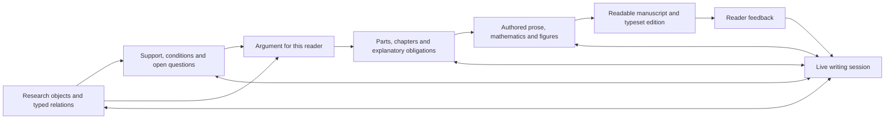

# From conceptric to master manuscript

Assessment and proposed development sequence · 26 September 2026 · Eigen

**Scope confirmed by Gerard later in this sitting:** this is a comprehensive upgrade of the existing scanner, walk, editor and pipeline, woven into Laplace. All of synthetics must be able to use it: framing, result development, numerical work, house-style assets, manuscript formation, glossary/link integrity and continuous correction. Live sessions need provider/model selection. Lean integration is investigated below as a proposed addition to result verification. This document records the assessment and design; implementation remains to be carried out.

The next writing system should let Gerard develop the account while working in it: explain a concept, inspect its support, change the argument, draft a passage, and see the consequences in the same session. The manuscript should remain connected to the research and implementation that justify it throughout that work.

The existing system contains useful machinery, but the authoring workflow needs redesign as well as reconnection. It divides writing into isolated section jobs and relies on a later pass to repair the resulting seams. A book that consolidates developing theory and several implementations needs continuous authorship and a sustained argument at every scale. Reusing the scanner and evidence mechanisms does not require preserving those workflow boundaries.

This is an audit and development proposal, not a claim that those changes have been implemented. It covers current source, seven manuscript read probes, the running local interface, an isolated nested-book example, and a bounded test run. It does not certify the full research pipeline or either provider's live session integration.

## The purpose this system must serve

In the [23 September meeting transcript](../evidence/call_2026-09-23_jack-hampson-andrew-graham/transcript_granola.md), particularly lines 175–183, 239 and 375–379, Gerard identifies the bottleneck: the theory and its implementation need to be brought together into an account an outsider can follow before other people can contribute effectively. The 25 September packaging session adds useful requirements: navigate from the whole to individual pieces, inspect actual code and sources, and distinguish established results from prototypes and remaining integration.

The current instruction extends that into a potentially book-length master document. Its organising problem is therefore both intellectual and practical:

- Establish the common theory across papers written in different settings and vocabularies.
- Explain how each principle becomes an operation, data structure, algorithm or engineering constraint.
- Locate what has actually been implemented and measured, with the conditions of that evidence.
- Let readers learn the account progressively and let contributors descend to reproducible details.
- Keep that account maintainable as the research and implementation change.

The master manuscript is one authored account. It can live in chapter files and have several renderings. Its coherence does not require one enormous source file or one model context.

## What the current pipeline already contributes

The stage modules contain more than a simple graph-to-text generator. Reuse them selectively as evidence, editing, execution and rendering mechanisms. Their existence does not justify retaining the current division of authoring work.

| Existing stage | Contribution | Relevant code |
|---|---|---|
| Conceptric and evolution | Typed concepts, relations, source material, append-only changes, research gaps and proposed structural changes | `corpus_ingest.py`, `pipeline/schema.py`, `pipeline/evolve.py`, `pipeline/growth.py` |
| Manuscript specification | Purpose, audience, scope, terminology, equation roles, figures and tables | `pipeline/projection_spec.py` |
| Structure | Placement, section questions, reader entry/exit states, dependency checks | `pipeline/structural.py`, `storyboard.py` |
| Narrative | Explanatory obligations and connections for a section, plus author architecture guidance | `pipeline/narrative.py` |
| Realisation | Compiled packets for prose and research work, with provenance | `pipeline/dispatch.py`, `pipeline/document_model.py` |
| Assembly | TeX, figures, tables and bibliography | `pipeline/tex_backend.py`, `pipeline/bibliography_stage.py` |
| Review and revision | Mechanical checks, reader passes, evidence/citation work, feedback routing and selective regeneration | `pipeline/readers/`, `pipeline/citation_direction.py`, `pipeline/propagate.py` |
| Release | Candidate versions, source and artifact hashes, final-document review | `pipeline/release.py`, `pipeline/drift.py`, `pipeline/visual_gate.py` |
| Author interaction | Source-addressed reading, rewrites, notes, edit history and PDF access | `walk.py`, `static_shared/walk.mjs`, `review_surface.py`, `projection_viewer.py` |

Several design choices are worth retaining: source-addressed edits; separate manuscript purpose and research content; section entry/exit states; evidence and equation roles; many-to-many plan/prose provenance; routing a problem to the stage that owns it; and separating machine checks from author acceptance.

The September 20 [writing ruling](../contract/proposals/law09_writing_guidance_20260920.json) is essential here. Plans fix scientific obligations, while writers may reorganise, merge and split exposition. The recent `document_model.validate_fidelity` implementation supports multiple plan IDs per paragraph. Historical language about “closed paragraph plans” must be read under that later instruction, not reinstated as compulsory paragraph shapes.

## Findings in the current implementation

### 1. The document identity is not reliable across the writing surfaces

The live default `/walk` selected `corpus-as-a-state` and showed an empty manuscript. Both HTTP and a fresh Python process returned `ok: true`, title `Untitled`, zero sections and zero blocks. The chosen file is `manuscript/whitepaper/main.tex`, a scaffold. The registered source at `manuscript/main.tex` is 400,339 bytes.

This is not resolved safely by choosing the largest or newest file. The project must explicitly distinguish research source, current authored manuscript, generated candidate and accepted release. All surfaces must resolve the same selected edition, with the PDF and auxiliary files tied to its build.

The seven-project probe gives the following bounded picture:

| Project | Observed walk result |
|---|---|
| corpus-as-a-state | Empty scaffold presented as a successful document |
| subset-sum-itqde | 11 sections, 360 blocks; 16 raw blocks including abstract, mathematical wrappers and tables |
| synthetics-genesis | One paragraph from an intentionally declared concept-only stub |
| paper_falqon | 13 sections, 347 blocks; no resolved bibliography/reference entries in this read |
| paper_roland_qrc | 12 sections, 187 blocks; source registry and projected manuscript point to different locations |
| free-snacks | Refuses with `no main.tex`; chosen review directory differs from the registered TeX root |
| superarc | 17 sections, 139 blocks; 12 raw blocks |

Different source and projection directories can be legitimate. Their roles and selected versions need to be explicit. A graph-only project should open as graph-only; an empty candidate should not stand in for a readable manuscript. The recent uncommitted bibliography-selection repair in `walk.py` was present before this audit and has been preserved.

Sources: [fresh probes](../evidence/WRITING_2026-09-26/probes.json), [HTTP probes](../evidence/WRITING_2026-09-26/http-probes.json); `review_surface.manuscript_dir`, `registry.Project.resolved_target_dir`, `walk.doc`.

### 2. The manuscript models are still shaped around papers

`schema.plan_sections` yields flat sections and appendices. `tex_backend.assemble_main_tex` emits those lists. `projection_viewer.doc_model` follows the root's immediate includes, and `walk._HEAD_RE` recognises sections through paragraphs but not parts or chapters. The separate `pipeline.document_model.build_document_model` also scans root-level inputs and strips directory components when locating fragments.

The isolated book fixture contains a part, a chapter include, and an inner section include. The walk returns success while omitting the inner section and recognising no headings. This is a concrete content-loss problem before performance becomes an issue.

Use a recursive outline with stable IDs, typed levels and ordered children. Share include traversal and source mapping across the editor, walk, document model and compiler. Preserve exact relative paths, detect cycles and missing includes, and retain unsupported content visibly. Chapter and part support must reach the underlying model, not just the navigation labels.

### 3. Relationship meaning is weakened before structure uses it

`structural._edge_kinds` explicitly recovers `draws`, `shares` and `validated_by` from a separate `conceptric_v1.json`, because the runtime dependency representation has flattened the distinction. Unrecognised relationships are treated as ordering constraints by the structural gate.

For this manuscript, “depends on this definition”, “supported by this experiment”, “implemented by this function”, “analogous to this construction” and “explained earlier for this reader” have different consequences. They must survive ingestion, editing, planning and reconstruction as distinct relations. An evidence dependency need not be an exposition-order dependency; an analogy must never become a proof.

Repair that passage through the existing conceptric adapter first. The writing project need not wait for completion of every Atlas migration.

### 4. Provenance exists, but its joins do not yet constitute a complete support chain

`narrative_packet` places each selected concept into `objects` as its kind, essence and LaTeX label. It also carries paragraph obligations, equation metadata and bibliography entries. That is useful, but this path does not itself carry the underlying proof, exact source passage, experiment conditions or implementation observation.

`document_model.validate_fidelity` checks coverage, markers, declared qualifications, citations and anchors. These are valuable integrity checks. They cannot by themselves establish that the prose correctly states an inference or that a cited source supports its wording. Likewise, `citation_audit._claim_to_source` enriches explicit links with citations near a claim; that mapping is not an entailment judgement.

There is already stronger machinery to reuse: `citation_direction.py` distinguishes entailment, non-entailment and insufficient text, and the derivation organ records forged links and remaining gaps. The requirement is to join those results into what planning, generation and review actually consume, while preserving the distinction between a compiled judge packet and a completed judgement.

This audit does not conclude that the whole repository lacks semantic checking. It identifies where the inspected manuscript path carries weaker information than the eventual claim needs.

### 5. The planned reader journey is too closely tied to unique node placement

The structural gate normally gives a node one introduction and requires explicit exceptions for repeated placement. Reader-state computation records that first location and later one-hop uses. This is a useful beginning, but a book needs a richer relationship between a concept and its occurrences.

A central concept may be motivated in the introduction, defined carefully in a foundations chapter, proved under assumptions later, implemented in an engineering chapter, and recalled in an example. Those are different teaching acts over the same research object. The manuscript should represent those roles explicitly instead of treating each occurrence as duplication or a special waiver.

### 6. Incremental machinery exists, but membership is not semantic freshness

`storyboard.dirty_report` compares planned node IDs with `% NODES` markers. A node can change its statement, assumptions or evidence while keeping its ID. `propagate` additionally consumes explicit ledger changes and feedback, so it is more capable than that membership check alone; however, its change-set leg is skipped when `since` is absent. Its default feedback read scans the ledger.

Each generated object should record the revisions of the content, evidence, plan and relevant guidance it consumed. A changed result should invalidate its dependent claims, figures and passages even if their IDs remain unchanged. Keep the existing distinction between cheap assembly changes and work requiring a model, but compute it from typed dependency changes.

The target is work proportional to the affected dependency closure. A global definition or ordering change can legitimately affect much of the book. Final pagination can also be global: `drift.py` already notes that a local prose edit may move distant pages. Do not confuse selective intellectual regeneration with a guarantee of local PDF reflow.

### 7. Live interaction is split between deposits and historical transport

The walk's “session” rail contains this reading pass's deposits. It is not an active model conversation. Its requests for references, figures and sections become comments with a `request:` prefix. `walk_requests.collect` classifies them, but a source search finds no production caller; `scripts/atlas_s0_inventory.py` already records this fact. Generic feedback paths still exist, so this is specifically the missing typed-request consumer.

The old `/front/talk` route does bank messages and attempt asynchronous routing. It resolves logical seats through Atlas and uses the retired transport model. The current `/front` Conversation view, inspected in the browser, showed delivery states as `UNKNOWN` and provided no message composer in that view. These are existing pieces, not a demonstrated current author-to-session-to-manuscript loop.

Reuse the durable message identity, exact anchors and incremental event delivery. Replace the dependency on fixed seats and watcher operation with an explicitly connected writing session. Custody/Fabric remains OFF.

### 8. The portable execution path covers less than the manuscript pipeline

`docs/workflows.md` explicitly limits the current Python workflow carrier to bounded `derive` work through Codex CLI. It does not port the historical Claude manuscript workflow or sealed visual readers. The manuscript stages still have substantial drivers in `.claude/workflows/project-staged.js` and related workflows.

The stage artifacts also differ by project: SSG and FALQON have specification, contracts and narrative/provenance files; several newer research projects do not have those artifacts at the registered locations. A missing materialized artifact is not proof that no equivalent research exists elsewhere. It does mean registration alone has not established a uniform, editable pipeline.

Expose real stage capabilities through one runner interface. Reuse the existing packet compilers and result validators, then port stages as exercised. Do not label the whole manuscript pipeline provider-neutral because one dispatch path is.

## A better account of manuscript formation

The conceptric should preserve the research independently of any one manuscript. A manuscript then selects and explains part of that research for a particular reader and purpose. Three connected views make that transformation explicit.

**Research view:** definitions, questions, claims, assumptions, derivations, algorithms, implementations and results, with their typed relationships and versioned source material. Preserve full reconstructable substance behind concise node summaries. An essence is an entry point, not a replacement for a derivation.

**Evidence view:** why a particular claim may be stated at a particular strength and scope. A support record joins the claim revision to an exact proof, source passage, experiment or code observation, carries its conditions, and records what was checked and by whom. Support and counterevidence can coexist. A record's existence or hash verifies identity; it does not establish truth.

**Reader view:** an ordered explanation chosen for an audience. Each chapter or smaller movement answers a question, assumes some prior understanding, introduces or uses particular concepts, and leaves the reader able to do something new. Several occurrences can refer to the same concept without copying its authoritative definition.

These are views and relations over shared objects, not a proposal for three independently maintained copies of the research.



The process should work in both directions. Starting from the intended explanation reveals which claims and demonstrations are needed. Starting from the available research establishes which claims are justified and where further work is required. Drafting is allowed to reveal a missing definition or inference; that discovery returns to the owning research or planning stage.

| Transformation | What it must settle | What it must preserve |
|---|---|---|
| Sources → research objects | Identity, meaning, relations and unresolved interpretations | Exact source revisions and the ability to reconstruct the original material |
| Research → supported argument | Main question, conclusions, qualifications and required evidence | Claim strength, assumptions, disagreements and gaps |
| Argument → reader journey | Order, motivation, examples, definitions, proofs and implementation explanations | The distinction between logical dependency and teaching order |
| Journey → chapter/section obligations | What this passage must establish and what the reader knows around it | Links to concepts, evidence, notation and neighbouring obligations |
| Obligations → expression | Connected prose, equations, diagrams and explanations | Scientific content and many-to-many provenance, with freedom over paragraph shape |
| Expression → review | Correctness, support, comprehensibility, coherence and visual quality | Separate outcomes for each dimension; a successful compile cannot stand for all of them |
| Accepted change → new version | What changed and which descendants require attention | Author edits, prior versions, current support and the selected document edition |

This changes the work the existing stages perform and how they are scheduled. Explicit support and occurrence roles preserve the connection to research, but do not by themselves create a coherent argument. The authoring redesign below is necessary alongside those data-model repairs.

## Replace atomised drafting with sustained authorship

Gerard's further correction in this sitting is decisive: the present workflows atomise the work too much and produce disjointed writing. The remedy must address how the argument is formed, not only improve the exchange of records between stages.

There is direct source evidence for the mechanism. `.claude/workflows/project-staged.js:137–179` launches independent narrative planners and prose writers by section. Its prose prompt says everything needed is in the packet and instructs the writer to read nothing else. Lines 205–228 then commission a global rewrite of the assembled fragments with frozen substance and byte-identical markers. That gives local writers limited authority over the argument and asks a late writer to repair it under constraints that may preserve the bad division.

The newer `PROSE_STAGE_PREAMBLE` relaxes paragraph shape, which is an improvement, but the surrounding workflow still isolates sections. `narrative.validate_narrative` checks coverage, nonempty propositions, distinct function strings and the presence of `from_previous`/`to_next` fields. These establish structural completeness of a plan. They do not establish that one thought motivates the next. `structural.compute_reader_state` records first node placement and later one-hop uses; it does not demonstrate reader understanding. These mechanisms should report the limited things they measure.

### Three orders that should not be conflated

| Order | Question it answers | How to establish it |
|---|---|---|
| Logical and evidential order | What must hold for this conclusion, and what supports it? | Explicit assumptions, derivation/inference links, evidence and proof dependencies |
| Explanatory order | Why does the reader need the next idea, and what can they understand at this point? | An authored argument with motivating questions, examples, obstacles, consequences and deliberate returns |
| Execution order | What work can run now, and which work depends on its result? | The scheduler's actual input/output dependencies, including independent experiments and proof obligations |

A valid dependency ordering constrains an explanation but does not determine it. An opening example can motivate a definition that is formalised later. A claim can be announced before its proof if its status and the deferred obligation are clear. A mathematical implication, an experimental cause and a pedagogical transition are also different relations. Similarity and co-occurrence must not silently produce any of them.

Building the argument means making the *reason for the next step* explicit. A useful outline can be read as a connected explanation: the problem creates a need; an available approach leaves an obstacle; a construction addresses that obstacle; the result changes what can be done; the next question follows from that consequence. This is an example of reasoning to inspect, not a mandatory five-slot template for every chapter.

Before distributing prose work, draft a continuous account of the intended argument with the author. It may contain a running example, a sketch of the mechanism, tentative figures and open questions. This exposes missing connections earlier than assigning every node to a paragraph. The result should be readable as an argument without opening the entire conceptric or completing a form for every sentence.

### The writing unit follows the argument

Keep fine-grained identities for results, equations, evidence, citations and edit anchors. Choose the scope of a writing task separately: enough connected material to carry a question through to an intelligible conclusion. That scope can cross section boundaries. A section boundary or a fixed token count is not automatically an appropriate authorship boundary.

One continuing authoring context should own the active chapter or connected stretch of argument, with the live author steering it. It needs the whole-book purpose, the current argument, the actual relevant surrounding prose, shared notation and access to the supporting research. It should be allowed to revise the order and extent of the passage when the explanation requires it, while returning substantive changes to the research objects for checking.

This does not require carrying the whole book and all its sources into every turn. Keep a compact authored account of the whole argument, exact references to supporting objects, and the full text of the active stretch and relevant boundaries. Retrieve additional evidence as needed. When changing chapters or replacing a provider, reconstruct that state and verify the handover against the actual draft. A summary alone is insufficient where wording and emphasis at a join matter.

Parallel workers are useful for independent calculations, literature questions, proof attempts, figure production and challenges to a claim. Their returns are material for the continuing writer. Parallel prose generation should be reserved for genuinely separable pieces with settled interfaces; it should not be the default merely because the manuscript has several sections.

The writer develops the explanation directly in its intended register. A final whole-document read remains useful, but a separate voice pass cannot repair missing reasoning by changing the tone. House style should guide figures, notation, typography and expression throughout, with the author able to correct it in context.

### Change the existing orchestration at these seams

- `storyboard` and `pipeline/structural` should hold the authored argument and distinguish necessary logical prerequisites from the chosen reading path. Section placement becomes one view of that argument.
- `pipeline/narrative` should provide the active writing scope, scientific obligations, relevant evidence and surrounding argument. Mandatory paragraph allocation and unique function strings should cease to be the definition of narrative readiness.
- `pipeline/dispatch` should compile that coherent scope with access to its grounds and neighbouring text, replacing the restrictive section-only packet for authoring work. Content/policy separation still matters; context starvation is not required for it.
- `project-staged` and its portable execution equivalent should run the continuing authoring loop and dispatch independent research tasks when needed. Deterministic compilation and verification belong in code, not in agents instructed merely to run commands.
- The existing scanner/storyboard/walk should show the current argument and the live discussion alongside the draft, with direct access to supporting results. Reordering or rewriting should preserve identity and evidence while showing which larger argument needs rereading.
- Review should happen when it can change the work: on the proposed argument, on an early coherent draft, on changed claims and on the final assembled document. Mechanical candidate lock must not be a prerequisite for discovering that the explanation is wrong.

Incremental revision still matters, but a connected explanation may require revising a larger span than the changed evidence node. Compute the exact scientific dependencies, then let the writer inspect the smallest coherent surrounding argument. Recheck chapter/book consequences when the change affects their conclusions or promises. Avoid both whole-book regeneration for a typo and paragraph-only repair when the argument has moved.

Acceptance should include a direct comparison with the current workflow on the same representative material. Can a fresh reader explain why the central construction was introduced, how it resolves the stated problem, which assumptions matter, and how it connects to implementation? Where does the reader lose the thread? Correct evidence, compilation and link checks remain necessary, but should not be presented as answers to those questions.

## Evidence for a theory-and-implementation book

The master account crosses evidence types. Each needs its own scope:

| Statement | Appropriate support |
|---|---|
| Mathematical result | Derivation or proof with explicit assumptions; numerical checks can supplement it |
| Generalisation from a quantum setting | An explicit translation of objects, generator and algebra, with retained and changed assumptions |
| Algorithm or representation proposal | Operational definition, argument for its properties, and stated unresolved obligations |
| Implemented mechanism | Identifiable code and interfaces at a revision, plus execution evidence where behavior is claimed |
| Measured performance | Code/configuration/data/environment, measurements, comparison and tested range |
| Integrated capability | A run through the connected components at recorded versions |
| Remaining work | The missing connection or result and an observation that would establish completion |

Link these records from the readable text without filling the prose with internal receipts. The reader should be able to open the proof, source, experiment or implementation that matters. Existing scientific manuscripts can remain sources while the master account develops a consistent vocabulary and argument; assembling their PDFs is not that synthesis.

For example, suppose a chapter makes an efficiency claim about incremental reconstruction. Its mathematical statement may concern an affected dependency set, while an implementation observation shows how many records a particular update read. Those are related but different claims. If a new run finds an unexpected full scan, the implementation claim and the passages relying on that measurement become stale. The theorem remains unchanged unless the new observation challenges one of its assumptions or its reasoning. A selective update must preserve that distinction.

Every figure should similarly connect its explanatory purpose to a generator or authored diagram source and, where applicable, exact data. Changing a dataset can invalidate a plot and its interpretation without requiring a rewrite of every surrounding chapter.

## The live session front end

Yes, it is feasible. The useful unit is a writing session attached to the project and its current object: a concept, evidence item, argument, chapter, paragraph, equation or figure.

The workspace should offer an outline or concept navigation area, the current working object, and a discussion/evidence area that opens alongside it. Moving between concept, plan, prose and source should retain the selection and discussion. Technical coordination diagnostics belong behind a status detail, not in the main writing path.

A selected passage should support ordinary actions such as “explain this”, “what supports this?”, “rewrite with this emphasis”, “this result changes”, or “move this argument earlier”. The session sees the selected object's revision, its relevant dependencies, the manuscript purpose and enough neighbouring context to work accurately. It can retrieve deeper evidence when required.

The same conversation can return an explanation, a proposed change, a missing-evidence task or a completed authorised edit. Questions do not automatically become manuscript edits. Explicit editing requests can use the session's standing editing scope without a new confirmation ritual for every sentence. Proposed conceptual changes should show their consequence for the affected claims and text.

Implementation shape:

1. A project/session binding links a durable writing-session ID to a provider conversation and the current manuscript/selection. Provider replacement must not erase the document discussion or the accepted decisions.
2. The existing message journal is extended or migrated deliberately to carry object anchors, base revisions, request IDs and operation state. Avoid an unrelated second feedback inbox.
3. A provider adapter starts/resumes conversation, sends input, streams replies and progress, supports interruption, and reports disconnects. The browser talks to the local writing service; provider transport stays behind that service.
4. A small set of stage operations exposes reconstruction, evidence inspection, plan edits, draft proposals, application and validation. Existing executors remain responsible for their stages.
5. Changes use stable object IDs plus base revisions and the existing byte guards. Concurrent author edits produce a visible comparison, not a guessed overwrite. Applied changes and operation results reconnect to the originating turn.
6. Reconnect restores persisted turns and operation outcomes before resuming streaming. A completed answer, an applied edit and a validated manuscript remain distinct states.

For Codex, the installed CLI's generated schema contains thread start/resume/read, turn start/steer/interrupt, streamed message deltas and turn completion. These match the documented app-server integration capabilities. The current `provider_queue.py` discards notifications while waiting for its queue RPC result; it is not itself a conversation client. A persistent adapter is needed. [Official app-server documentation](https://learn.chatgpt.com/docs/app-server); [local capability probe](../evidence/WRITING_2026-09-26/provider-capabilities.json).

That verifies a supported integration route, not a working Laplace connection or the ability to attach safely to any arbitrary already-running desktop task. Provider attachment, event recovery and live editing still require an actual end-to-end run. Other providers should implement the same small contract only after their equivalent capabilities are verified.

## Upgrade the existing scanner and its producers and consumers

The scanner already owns the HTTP routes, the walk already supports source-addressed reading and edits, and the editor, storyboard, assets and pipeline panels already exist. Their upgrade is the implementation surface of this programme. A common object and operation contract should join those surfaces without creating another application or duplicating their stores.

The source review found useful machinery beyond the first audit. The original Foundry and [evidence-flow design](../src/laplace/pipeline/canon/wiki/workflow/evidence_schema_flow.md) already describe stable result IDs joining statements, derivations, literature, numerical checks and explanatory context. The [core-outward workflow](../src/laplace/pipeline/canon/wiki/workflow/core_outward_trunk.md) is explicitly re-enterable. Those ideas predate this proposal and should be recovered in implementation. They are not, by themselves, proof of connected runtime behavior: for example, the historical reconciler skill names `scripts/reconcile.py`, which is absent from the current scripts directory.

The key acceptance rule for an upgrade is a complete path:

**author action → owning operation → versioned result → affected consumers → visible update and recoverable history.**

Each path must name an actual producer and consumer. The existence of a panel, schema, file, request row or successful unit test does not establish that the path is connected.

| User activity | Existing producers and stores to build on | Existing consumers to connect or upgrade | Completion evidence |
|---|---|---|---|
| Settle framing | Aspiration, growth/rulings, manuscript specification | Growth/storyboard/pipeline panels; structural and narrative compilers | A changed purpose, audience or contribution changes the relevant planning obligations and is visible to the next writing turn |
| Build and verify results | Conceptric nodes and typed relations, derivation links, evidence records | Result inspection, planning packets, evidence checks, manuscript occurrences | The reader can reach the exact statement, assumptions and support; a revision updates the dependent views |
| Develop numerics | Existing project scripts, configuration, result/run manifests | `front_research_compute`, pipeline state and asset generation | The visible result comes from the selected run and names its conditions, uncertainty and verification outcome |
| Produce figures | Figure specifications, existing generators, `figure_runner`, figure manifest | `asset_model`, `/assets`, TeX assembly, manuscript preview | The same result, figure, panels, caption and manuscript location remain linked after regeneration |
| Apply house style | Typography profiles, figure standard, templates and current checks | Existing convergence driver, asset assessment, preview and release | Deterministic requirements and visual judgement are both returned to the originating object |
| Maintain vocabulary and links | `def:` nodes, aliases, notation and equation identities | Glossary renderer, specification, editor/walk occurrence links, reference checks | A term or symbol opens the right definition in context; a revision preserves or explicitly contests its uses |
| Work with a live session | Existing scanner routes, durable turn identity, anchored context, dispatch | Session panel in current surfaces and provider adapters | An authored turn is answered; authorised edits update the same object; interruption and reconnect preserve outcomes |
| Bank a correction | Existing feedback, author-edit, ruling and session-memory mechanisms | Relevant planners, generators, verification and displayed history | The applicable correction is consumed or contested, and its resulting change can be inspected |

The numerics review identified two especially concrete joins to repair. `front_research_compute.py` and `research_compute_surface.mjs` exist, but no production scanner route or importer was found in the reviewed source. Separately, `figure_runner` writes `figure_manifest.json`, which the pipeline card reads, while `asset_model` discovers files and ledger information without consuming that manifest. A numerical view and an asset view can therefore describe related work without sharing its actual production record.

The figure runner also contains two FALQON-specific placement records and lexical matching between prose promises and generator descriptions. Preserve its execution, unresolved-intent and placement mechanisms, but give them declared result/figure/occurrence identities from the conceptric and manuscript plan. A general synthetics workflow cannot depend on plot names accidentally matching prose or on `s6.tex` and `s8.tex` as universal destinations.

House-style checking does have a production consumer: `.claude/workflows/fixedpoint_mechround.py` imports and runs it. That was independently checked during synthesis and corrects an overbroad initial worker finding. The remaining task is to expose those existing findings consistently in scanner assets and portable stage execution, and to connect the remaining figure checks. Preserve the current effective house style and its rule status rather than introducing fresh aesthetic quotas.

Detailed source references and remaining uncertainty are in the [numerics review](../evidence/WRITING_2026-09-26/numerics-review.json) and [authoring review](../evidence/WRITING_2026-09-26/authoring-review.json). Their acceptance examples are proposed tests, not observed passes.

### Framing, result development and numerical work

Framing is revisable research input. Keep the intended reader, main question, motivating example, contribution and desired reach attached to the project. The results constrain what the framing can honestly say; the framing identifies the missing results or demonstrations that would make the work useful. That interaction belongs in the existing aspiration/growth/specification path.

Numerical work should begin from a result and an explicit experimental question. Its record should identify assumptions, variables, parameter regime, method, independent comparison where applicable, expected relationship, uncertainty and acceptance criterion. Tolerances must be appropriate to that experiment; a general default percentage is not a scientific standard for every result.

Keep design, smoke validation, execution, analysis and presentation as distinct operations in the same project. A plotting change consumes stored results without rerunning a costly simulation. A changed experiment configuration invalidates the relevant results and downstream assets. A presentation-only change should leave numerical and mathematical status intact. Work can be stopped, resumed and inspected without losing the run-to-result connection.

The UI needs ordinary controls for these activities in the existing pipeline and asset panels: inspect the experiment, edit its configuration, run a bounded check, start/stop the selected run, inspect a comparison, regenerate its figure, and return to the passage that uses it. Operation state must come from the executor and stored result, not from a button's optimistic success message.

### Glossaries and manuscript links begin with concept identity

This already has a source-side foundation. `verify.check_glossary` reads canonical terms, aliases and deprecated aliases from `def:` nodes, and `scripts/render_glossary.py` derives the glossary from those definitions. The missing general join is from that identity through every manuscript occurrence and its context. The current prose notation audit mainly detects spelling/orthography forks and is not that resolver.

A definition should carry stable identity, mathematical meaning, assumptions, accepted names, relevant notation and its scope. A manuscript occurrence refers to that identity with a role such as introduction, use, restatement or implementation example. The glossary, symbol index, hover definition, equation link and chapter cross-reference are then projections of the same relationships.

Do not blindly link every matching string: one symbol can denote different things in different contexts, and different papers can use different names for the same object. Resolve known cases through declarations and context; surface ambiguity where it remains. Renaming a concept and changing its definition are distinct operations. The former usually updates presentation; the latter can change the mathematics and its dependents.

### Live sessions, model selection and correction banking

The live panel belongs alongside the object currently being worked on in the scanner, walk or editor. It should retain the selected project, edition, concept/passage, evidence and reading position across transitions. The existing focus/return machinery in `static_shared/engine.mjs` is useful here. The walk's separate layout can consume the same session endpoints without inheriting every other surface's chrome.

The panel should expose connected provider, model and effort, with project defaults and explicit per-session or per-operation overrides. Model discovery must use the adapter's current capabilities. Retain provider-neutral intelligence tiers for automatic dispatch, but separate them from literal model IDs: `schema.MODEL_RANK` still uses historical provider labels, and unknown strings currently clamp to a ceiling. A selected model must either be used and recorded or produce a clear unavailable-selection outcome.

Record both requested and actual provider/model/effort and the operation capability used. Live conversation, a numerical coding job, a proof attempt and visual review can have different requirements. Switching providers requires a bounded handover of project state, decisions and open work; it must not claim to preserve private provider conversation state that cannot be transferred. The selector should accurately show whether the change affects the next turn or requires a session handover.

Banking a correction should preserve its words, target, scope, reason, source revision and supersession history, and connect it to subsequent work. Existing correction retrieval and session-memory resolution must be reused. The user should be able to see that a correction affected a later plan, generation or verification result, or why it remains unresolved.

Separate the kinds of correction. A wording preference may have a passage or project exception. A mathematical correction revises a claim or assumption and must not be treated as a local style override. A request for evidence creates research work. A note can remain a note. Global craft rules require the author's intended global scope; a local repair must not silently become permanent writing law. Concurrent changes need a visible conflict state, not a guessed latest-wins resolution.

## Lean as a verification component of result conceptrics

Lean is a good fit for an additional proof-producing and proof-checking path. It can give a result a formal statement, checked proof and explicit formal dependencies. The manuscript still needs the human derivation and the connection between that formal statement and the scientific claim. This is an integration design, not a completed formalisation.

The local discovery found no `.lean`, `lean-toolchain` or Lake project files in the repository file inventory, and `lean`, `lake` and `elan` were not on the current PATH. No Lean toolchain was installed and no proof was executed during this assessment.

Attach a formalisation record to the existing result identity. The record should bind the exact result revision and assumptions to a Lean declaration, a pinned toolchain/library revision, the proof sources and the check result. Record formal-statement alignment separately: a valid proof of a weaker or different proposition does not establish the manuscript's claim. Extract formal dependency information through Lean's environment/export mechanisms rather than guessing it from textual names.

Use that formal dependency view to enrich the conceptric's verification edges. It cannot supply every meaningful relationship in the research: motivation, analogy, empirical relevance, interpretation and pedagogical order remain distinct authored or judged relations.

Lean tracks axioms transitively, including the `sorryAx` used by unfinished proofs. An apparently successful build can therefore contain proof holes or depend on additional assumptions. The verification adapter must inspect the proof's trust basis and exact statement, not merely process exit status. [Lean axiom documentation](https://lean-lang.org/doc/reference/latest/Axioms/).

Current Lean documentation describes `lake check` and a comparator that can check a submitted proof against separately specified theorem statements and permitted axioms. Evaluate those capabilities when choosing and pinning the actual toolchain; they have not been exercised locally. Keep an explicit unavailable-check outcome when a required facility cannot run. [Proof validation](https://lean-lang.org/doc/reference/latest/ValidatingProofs/), [Lake build and checking tools](https://lean-lang.org/doc/reference/latest/Build-Tools-and-Distribution/Lake/).

The integration should expose separate states for an informal derivation, a formal statement, a completed proof, alignment with the intended claim, numerical support and an implementation observation. These can advance independently. Formal proof establishes a proposition under its formal assumptions; it does not automatically establish physical applicability, measured performance, floating-point behavior or correctness of a separate Python implementation.

Lean Blueprint is a relevant bridge to inspect: it connects LaTeX statements to Lean declaration names and distinguishes statement dependencies from proof dependencies. Its declaration-existence check is weaker than proving that the prose and theorem agree. Use it as an optional export/view over Laplace's result identities, avoiding a separately maintained mathematical graph. [Lean Blueprint project documentation](https://github.com/PatrickMassot/leanblueprint).

The first proof integration should target a small, precisely scoped identity needed by the selected real result. It should include a deliberately changed assumption and a proof hole as negative controls. Success means the scanner can show the result, exact formal statement and check evidence; changing the result marks the binding stale; repairing it updates that same result's verification view. Then connect the result's numerical example, house-style figure and manuscript occurrence through the existing pipeline.

Partial formalisation must remain useful. Drafting can proceed with accurately identified gaps. Requiring every result to be formalised, numerically tested and empirically demonstrated regardless of its kind would put the schema in charge of the research. Each claim needs the forms of evidence appropriate to what it asserts.

## Development sequence

### First: establish the argument and one coherent writing project

Select a real chapter-sized part of the master account as the pilot, with a concept, an equation, implementation evidence, a figure and a cross-reference. Develop its continuous argument with the author and use it to choose the writing scope and research tasks. Do not use the current section-fanout workflow as the pilot's default writer.

Alongside that, make the source/edition selection explicit; distinguish graph-only, draft and release states; fix the empty-success behavior; and introduce recursive document traversal and stable outline IDs. Preserve the existing source-safe edit path.

In the same slice, carry typed research relationships and exact evidence references through the existing pipeline adapter. This is what makes the pilot a test of manuscript formation rather than a chat demonstration.

### Second: complete one whole authoring loop

Use that pilot to exercise concept → supported argument → reader journey → draft → live question/correction → affected-stage update → rendered manuscript. Join the conversation to those objects and show what changed. Implement provider execution only for the operations this loop needs, using existing packet compilers and validators.

This is the first useful completion condition: Gerard can develop a real explanation in the system without copying context between windows, and inspect why its claims are warranted.

### Third: make that loop scale across the book

Add chapter navigation and lazy loading, content-revision invalidation, resumable work, explicit occurrence roles, shared notation and terminology, and cross-chapter dependency handling. Keep unfinished chapters writable and readable with visible gaps. A missing figure or open derivation in one chapter should not prohibit useful drafting elsewhere.

Stage readiness should be local to the work being attempted. Freeze accepted passages deliberately; do not convert every draft into a miniature release ceremony. Retain whole-book checks for cross-references, conceptual consistency, bibliography, reader progression and final layout.

### Fourth: improve judgement from observed writing failures

Separate correctness, evidence support, reader comprehension and presentation. Use mechanical checks for mechanical facts; use grounded judgement for semantic claims and independent reader exercises for comprehensibility. Reader checks should ask someone to explain or use the presented idea, with enough access to its stated prerequisites, and report the exact place where understanding failed.

Reuse the writing-organ experiments where they help, but do not turn sentence labels, word overlap, style counts or compulsory shrinking into definitions of good writing. The latest writing ruling already rejects that substitution. A book often needs a longer explanation to teach a difficult connection properly.

## Acceptance through actual use

The first implementation should pass these user journeys, with recorded results:

1. Open the intended edition from a fresh start. The prose, PDF, bibliography, feedback and selected version agree; stubs and missing material are explicit.
2. Open a nested book. Every included section appears in order, with parts/chapters recognised and correct source addresses.
3. Select a concept or passage, ask about its support, and receive an answer in the same workspace that descends to the actual evidence.
4. Request an authorised rewrite, continue steering while it runs, and see the resulting change without losing position or unrelated edits.
5. Change a claim's content without changing its ID. Its dependent plans, text and figures become stale; unrelated work remains current.
6. Change experimental evidence. The implementation statements depending on it are reconsidered without silently upgrading or rewriting distinct mathematical claims.
7. Reorder chapters and reuse a concept for different explanatory roles. References, teaching prerequisites and provenance remain coherent.
8. Disconnect the browser or stop the provider. Reconnect recovers the discussion and operation outcome without resubmitting or applying the same change twice.
9. Review and compile a chapter, then the assembled book. A fresh reader can follow the argument and locate the implementation without prior session context.

Measure time to a useful chapter, amount of context manually copied, data loaded per navigation/change, model work repeated, unresolved evidence, and recovery behavior. Establish latency and scale targets from the pilot; avoid turning arbitrary budgets into permanent requirements.

## Evidence and limits of this assessment

The [read-only probe](../evidence/WRITING_2026-09-26/probe.py) can be rerun with:

```sh
scripts/laplace-python evidence/WRITING_2026-09-26/probe.py
```

It records source hashes, the checkout commit, manuscript read results, stage-artifact presence and the isolated book fixture. It makes no provider call, compile or live-document change. HTTP observations of the existing port-8770 listener are stored separately. Browser observations covered the empty default walk, populated SSG walk, and current Conversation room.

The bounded test command was:

```sh
scripts/laplace-python -m pytest -q tests/test_walk_requests.py tests/test_walk_gate.py tests/test_writing_guidance_dispatch.py
```

Result: **51 passed in 5.51 seconds**. This supports those specific mechanisms; it does not contradict the disconnected request consumer or missing book support. [Verification record](../evidence/WRITING_2026-09-26/verification.json).

No full manuscript generation, live provider exchange, fresh PDF build, performance scaling benchmark or independent end-to-end review was run. This audit added documentation and reproducible evidence; it did not change production behavior, restart services, activate Fabric, alter manuscripts, commit or publish anything.
